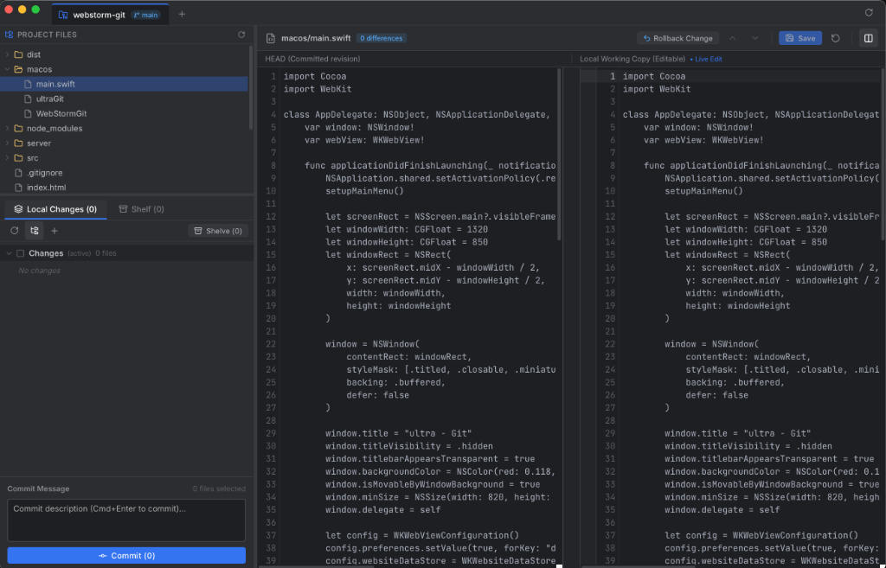

# ⚡️ ultra Git (Mac Native)

> **Ultrafast, ultralow-memory macOS Git GUI replicating *** Version Control workflow.**  
> Built for developers who want the speed, ergonomics, and power of WebStorm's Git tools without launching a heavy IDE or burning 500 MB+ of RAM with Electron.

<p align="center">
  
</p>

---

## 🚀 Why ultra Git?

* **⚡️ Ultrafast Launch (< 200ms):** Launches instantaneously on Apple Silicon and Intel Macs.
* **🪶 Ultralow Memory Footprint (~35 MB RAM):** Powered by native macOS **Swift (75 KB binary)** and system **WKWebView**. No heavy Chromium or Electron bloat.
* **⌨️ Live Editable Diff View:** Edit the working tree copy directly inside the diff editor. Press `Cmd+S` to save instantly to disk.
* **↩️ Per-Chunk Rollback Arrows:** Revert individual change hunks with a single click right in the line gutter.
* **📦 JetBrains Local Shelf:** Store and organize patches locally independent of `git stash`. Unshelve or delete anytime.
* **📂 Local Changes & Changelists:** Full support for `Default changelist`, custom changelists, drag/move files between changelists, and folder checkboxes in Tree View.
* **🌲 Project File Explorer:** Integrated file tree above Local Changes with instant lazy-loading and Git status colors.
* **📑 Multi-Project Tabs & Recent History:** Open multiple repositories simultaneously in tabs with a quick-access list of the last 10 opened projects.

---

## ✨ Features Breakdown

### 1. Interactive Diff & Live Editor (CodeMirror 6)
- **Side-by-Side & Unified Diff:** Compare HEAD with your local working copy.
- **In-Place Live Editing:** The right pane is a full-featured code editor. Modify your code directly inside the diff view, with syntax highlighting and automatic saving (`Cmd+S`).
- **One-Click Chunk Rollback:** Every changed hunk has an interactive rollback arrow (`↩`) in the gutter. Click it to revert just that specific change back to HEAD.
- **Auto-Scroll to First Change:** Automatically centers the view on the first difference when opening modified files.
- **Smart Untracked View:** When viewing untracked or new files, the empty left diff pane is automatically hidden, providing a clean full-width editor.
- **Difference Navigation:** Jump through changes with `F7` (Next Difference) and `Shift+F7` (Previous Difference).

### 2. Local Changes & Changelists
- **Directory Tree & Flat List:** Toggle between a hierarchical folder tree and a flat path list.
- **Folder Checkboxes:** Check or uncheck entire directories and all their sub-files with tri-state checkboxes.
- **Changelists Management:** Create custom changelists, move files between lists via context menu, and commit selected files with `Cmd+Enter`.
- **Status Indicators:** JetBrains color palette for Modified (Blue), Untracked/Added (Green), and Deleted (Grey).

### 3. Local Shelf (JetBrains Shelve)
- Shelve selected files or whole changelists into independent `.patch` files on disk with timestamps and descriptions.
- Review shelved files and their diffs.
- Unshelve changes back to your working copy (with optional *Keep in shelf* toggle).

### 4. Project Files Explorer
- Integrated folder explorer situated above Local Changes.
- Fast lazy directory loading (instant even on massive monorepos).
- Resizable horizontal splitter to adjust height between Project Files and Local Changes.

### 5. Multi-Project Tabs & Recent Projects History
- Open multiple Git repositories in tabs within a single native window.
- Fast project switcher and native macOS Finder folder picker (**Browse...**).
- Drag-and-drop any repository folder directly from Finder.
- **Recent Projects History:** Stores up to 10 recently opened projects with quick one-click reopening.

---

## 🛠️ Architecture & Tech Stack

```
┌────────────────────────────────────────────────────────┐
│               Native macOS Window                      │
│     (Swift 6 + WKWebView • 75 KB • ~35 MB RAM)         │
├────────────────────────────────────────────────────────┤
│           Vite + React 19 + TypeScript                 │
│      CodeMirror 6 (@codemirror/merge, @codemirror/view) │
├────────────────────────────────────────────────────────┤
│               Lightweight Local Backend                │
│       Native Node.js HTTP Daemon • Native Git CLI      │
└────────────────────────────────────────────────────────┘
```

---

## 🏁 Quick Start & Building

### Prerequisites
- macOS (Apple Silicon or Intel)
- Node.js (v18+)
- pnpm (`npm install -g pnpm`)
- Xcode Command Line Tools (`xcode-select --install` to provide `swiftc`)

---

### Option 1: Automatic Build & Run (Recommended)

Just run the launch script. It automatically builds the frontend and compiles the macOS binary if they are not already built:

```bash
# 1. Clone the repository
git clone https://github.com/your-username/ultra-git.git
cd ultra-git

# 2. Install dependencies
pnpm install

# 3. Launch (opens current repo or specified path)
./run.sh [optional/path/to/repo]
```

---

### Option 2: Manual Step-by-Step Build

If you prefer building each component manually or creating a standalone binary:

#### 1. Build the Web Frontend
Compiles TypeScript and bundles production assets via Vite:
```bash
pnpm run build
```
*Output: `dist/` directory containing minified HTML, CSS, and JS (build time: ~180ms).*

#### 2. Compile the Native macOS Binary
Compiles the lightweight Swift app using Apple's native `swiftc` compiler:
```bash
# Direct compilation with optimizations:
swiftc -O macos/main.swift -o macos/ultraGit

# Or via npm script:
pnpm run build:mac
```
*Output: `macos/ultraGit` (single native Mach-O executable, ~75 KB, 0 external runtime dependencies).*

#### 3. Build All in One Step
```bash
pnpm run build:all
```

#### 4. Run the Local Backend & Native Window Manually
```bash
# Start backend server for your repository:
node server/index.js /path/to/your/project &

# Launch native macOS window:
./macos/ultraGit "http://127.0.0.1:3737"
```
*(You can also simply navigate to `http://127.0.0.1:3737` in Chrome, Safari, or Arc).*

---

### Option 3: Development Mode (Hot Reloading)

For developing or contributing to the frontend with instant Hot Module Replacement (HMR):

```bash
# Terminal 1: Start local Git API backend
pnpm run server

# Terminal 2: Start Vite Dev Server with HMR
pnpm run dev
```
Open the printed Vite URL (e.g. `http://localhost:5173`) in your browser. All frontend changes will reload instantly.

---

### 📦 Optional: Packaging into a macOS `.app` Bundle

If you want to drag **ultra Git** into your macOS `/Applications` folder:

```bash
# Create app bundle structure
mkdir -p "ultra Git.app/Contents/MacOS"
mkdir -p "ultra Git.app/Contents/Resources"

# Copy compiled native binary
cp macos/ultraGit "ultra Git.app/Contents/MacOS/ultraGit"

# Create minimal Info.plist
cat << 'EOF' > "ultra Git.app/Contents/Info.plist"
<?xml version="1.0" encoding="UTF-8"?>
<!DOCTYPE plist PUBLIC "-//Apple//DTD PLIST 1.0//EN" "http://www.apple.com/DTDs/PropertyList-1.0.dtd">
<plist version="1.0">
<dict>
    <key>CFBundleExecutable</key>
    <string>ultraGit</string>
    <key>CFBundleIdentifier</key>
    <string>com.ultragit.app</string>
    <key>CFBundleName</key>
    <string>ultra Git</string>
    <key>CFBundlePackageType</key>
    <string>APPL</string>
    <key>CFBundleShortVersionString</key>
    <string>1.0.0</string>
    <key>LSMinimumSystemVersion</key>
    <string>12.0</string>
    <key>NSHighResolutionCapable</key>
    <true/>
</dict>
</plist>
EOF
```

---

## 💡 Keyboard Shortcuts

| Shortcut | Action |
|---|---|
| `Cmd + S` | Save modified file in Diff Editor directly to disk |
| `Cmd + Enter` | Commit selected files (when in Commit message box) |
| `F7` | Jump to Next Difference |
| `Shift + F7` | Jump to Previous Difference |
| `F5` / Refresh button | Refresh Git status & file tree |
| `Cmd + Q` | Quit application cleanly |

---

## 🎨 Open for Vibe-Coders! 🤝

**Vibe-coders, AI-assisted hackers, and open-source enthusiasts are warmly welcome!**

This codebase is intentionally designed to be clean, modular, and easy for AI agents (Cursor, Claude, Gemini, Copilot) and human developers to extend:
- **Zero bloat:** No complex build systems or convoluted state management.
- **Clean modular structure:** React components under `src/components/`, lightweight backend in `server/`, native shell in `macos/`.
- **Ideas for PRs:**
  - [ ] Git Log & Commit Graph visualization
  - [ ] Compare with Branch / Revision dialog
  - [ ] Git Stash tab (alongside Shelf)
  - [ ] Interactive 3-way Merge Conflict resolver
  - [ ] Custom themes (Classic Darcula, Light theme)

Feel free to open an issue or submit a Pull Request!

---

## ⚠️ Disclaimer & Responsibility / Отказ от ответственности

> **English:**
> **ultra Git** is a developer tool that directly interacts with your Git repositories, file system, and working tree (performing file edits, staging, commits, rollbacks, and shelving).
> 
> * **Git Version Control & Rollbacks:** Because this tool operates on top of standard Git, all committed history can be tracked and rolled back using Git's built-in commands (`git log`, `git reflog`, `git revert`, `git reset`).
> * **User Responsibility:** You are solely responsible for any changes made to your files, working tree, and repositories. Be aware that uncommitted changes rolled back via the rollback button (`↩`) or discarded cannot always be recovered by Git. Always ensure you have appropriate backups or stashes of sensitive work.
> * **"AS IS" Basis:** This software is provided "as is", without warranty of any kind, express or implied. The authors and contributors shall not be held liable for any data loss, unintended modifications, or repository issues arising from the use of this application.

> **Русский:**
> Приложение **ultra Git** напрямую работает с вашей локальной файловой системой и Git-репозиториями (редактирование файлов на диске, коммиты, откат изменений, перемещение файлов, шелвинг).
> 
> * **Откат и безопасность Git:** Поскольку приложение работает поверх стандартного Git, все зафиксированные коммиты сохраняются в истории Git и в любой момент могут быть проверены, отменены или возвращены с помощью стандартных механизмов Git (`git reflog`, `git reset`, `git revert`, `git checkout`).
> * **Ваша ответственность:** Любые операции с кодом, включая откат незакомиченных изменений, прямое сохранение правок на диск и манипуляции с ветками, находятся полностью под вашей личной ответственностью. Несохраненные или незакомиченные изменения после выполнения отката (rollback) могут быть утеряны безвозвратно.
> * **Отказ от претензий:** Программное обеспечение предоставляется по принципу «как есть» (AS IS), без каких-либо явных или подразумеваемых гарантий. Создатели и контрибьюторы не несут ответственности за возможную потерю данных, сбои или нежелательные изменения в ваших репозиториях.

---

## 📄 License

MIT License. Free to use, modify, and distribute.
